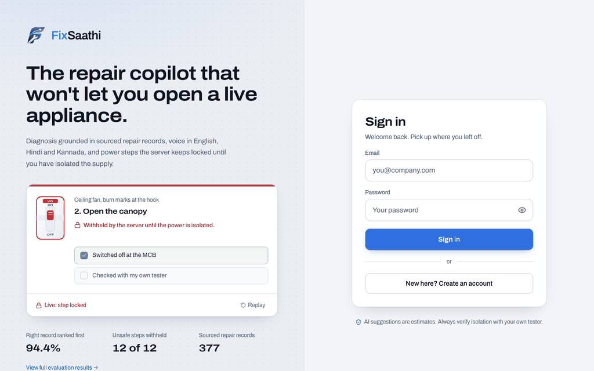
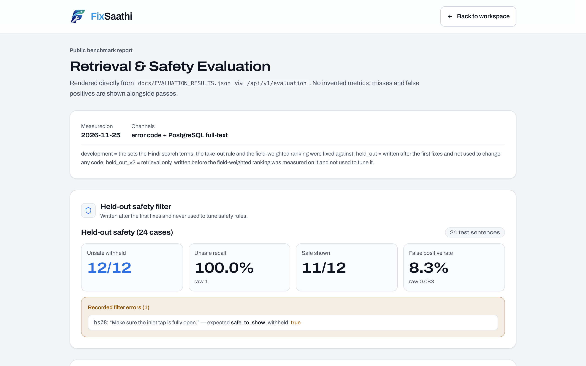
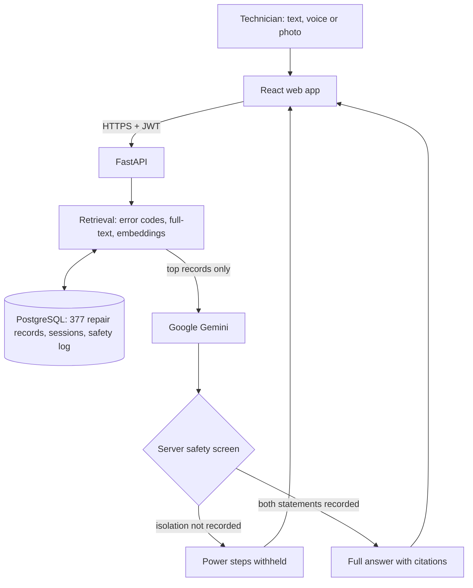

<div align="center">

# FixSaathi

**An AI repair copilot for appliance technicians in India: grounded diagnosis, a safety lock enforced by the server, and voice in English, Hindi and Kannada.**

[**Live app**](https://fixsaathi-vu9s.onrender.com) · [**Demo video (2:51)**](https://fixsaathi-vu9s.onrender.com/demo.mp4) · [API docs](https://fixsaathi-vu9s.onrender.com/docs) · [90s Demo Script](DEMO_SCRIPT.md) · [Model Usage](docs/MODEL_USAGE.md) · [Built During Hackathon](docs/BUILT_DURING_HACKATHON.md) · [Evaluation](docs/EVALUATION.md) · [Architecture](docs/ARCHITECTURE.md) · [Cloud Run Deploy](DEPLOY_CLOUDRUN.md)


[](https://github.com/priyamthakur275/FixSathi/actions/workflows/ci.yml)


[](LICENSE)

</div>

<p align="center">

<br><sub><b><a href="DEMO_SCRIPT.md">Read the 90-second demo script &amp; judge Q&amp;A</a></b> · <a href="docs/demo/fixsaathi-demo.mp4">Watch MP4 walkthrough (Demo: scripted sample, not live AI)</a> · Captured from a local run against the updated UI</sub>
</p>

<table>
<tr>
<td width="68%"></td>
<td width="32%"></td>
</tr>
<tr>
<td></td>
<td></td>
</tr>
</table>

<sub>Walkthrough and screenshots are from a local run. The chat and workspace show one of the app's built-in demo scenarios, which are labelled on screen as scripted sample content; the safety lock, the withheld step and the retrieved records are the real server code.</sub>

## The problem

Most AC, fridge and washing-machine repairs in India are done by independent technicians who work alone, with no service manual and no senior to call. They diagnose by trial and error, which wastes parts and time, and they sometimes work on appliances that are still live.

FixSaathi gives that technician a copilot on their phone: describe the fault by text, voice or photo, get a ranked diagnosis grounded in real repair records, then follow guided steps that the server will not reveal until the power is isolated. The service report writes itself.

## What it does

| | |
|---|---|
| **Grounded diagnosis** | Every answer is built from the repair records retrieved for that question (377 records: manufacturer documentation, the ApplianceDB error-code dataset and FixSaathi's own guidance). The server deletes any citation that was not retrieved, and marks a fault as unverified when no record supports it. |
| **Server-side safety lock** | Steps that need the power off are sent to the phone *without their instructions* until the technician records two statements: "power switched off at the MCB" and "checked with my own tester". AI chat and voice replies are screened sentence by sentence before anyone reads or hears them. Microwave internals are always handed over to authorised service. |
| **Nameplate & error display reader** | Upload a photo of a rating label or digital display; Gemini Vision extracts brand, model and error code to feed retrieval and lets the technician verify or correct them before diagnosis (falling back cleanly to manual entry when AI is unavailable). |
| **Server-screened SSE streaming** | Chat replies stream word-by-word over SSE while `StreamScreener` buffers lines/sentences on the server so no power-sensitive instruction leaks before isolation is recorded, with automatic fallback to standard REST replies. |
| **Expected readings (reference only)** | Nominal values and out-of-range meanings per appliance (`GET /expected-readings`), clearly framed as reference only — never instructions to work on live circuits. |
| **Voice, three languages** | Speak a fault, hear the answer: the mic dictates your message and replies are read aloud with Gemini text-to-speech (device voice as fallback). A Gemini Live voice-and-camera relay (`WS /api/v1/live/{id}`, safety-screened) is built and verified by the smoke test; it is not yet wired into the app screens. The interface works in English, Hindi and Kannada (plus high-contrast **Sunlight mode** and a Hindi-first Home toggle), and chat prompts use spoken Hindi with real technician part names. |
| **Photos and documents** | Attach appliance photos, a camera capture, PDFs or Word files. The server checks every file's real type and strips location data from photos. |
| **Fault finder** | Type an error code or a symptom ("LG CH38", "fan hums but does not spin") and get the matching records at once, straight from the knowledge base (with bounded TTL lookup caching): no AI call, no quota, works without a Gemini key. Checks that need the power isolated are sent locked, as in a session. |
| **Send to customer** | A finished report becomes a short plain-text summary of the visit (problem, work done, result, isolation recorded) to send on WhatsApp or copy. |
| **Answer feedback** | Thumbs up or down on each AI answer, with a note on what was wrong. When a job is closed the technician rates the guidance and says whether the AI's likely cause was right. The manager dashboard shows the repair funnel and the share of answers technicians found helpful. |
| **Public `/evaluation` & live checks** | Unauthenticated [`/evaluation`](docs/EVALUATION.md) page renders [`EVALUATION_RESULTS.json`](docs/EVALUATION_RESULTS.json) verbatim (passes, misses and false positives). Plus 30 technician questions graded against the deployed app; see [Results](#results). |
| **Reports and dashboard** | A service report and PDF built only from what was recorded in the session; a manager view with repair funnel, sessions, first-time-fix rate, escalations and ratings. |

## Results

Measured offline by [`backend/scripts/evaluate.py`](backend/scripts/evaluate.py) on hand-labelled fault descriptions written in the way technicians type them. Held-out v2 was written before the current ranking was run on it and was not used to tune anything. Details, method, every miss and which sets were used to change code: [docs/EVALUATION.md](docs/EVALUATION.md).

| Held-out sets | Result |
|---|---|
| Correct repair record ranked first (held-out v2, 36 queries; English, Hinglish, Hindi) | **94.4%**, up from 88.9% with the previous ranking (MRR 0.914 → 0.958) |
| Correct repair record in the top 3 (held-out v2 / held-out, 36 + 30 queries) | **94.4% / 100%** |
| Appliance detected correctly from free text (held-out / v2) | **96.7% / 97.2%** |
| Unsafe instructions withheld by the safety filter | **11 / 12** when first measured; 12 / 12 after the fix it led to |
| Safe text left readable | **11 / 12** |

These numbers cover retrieval (keyword and error-code channels, reproducible without an API key) and the safety rule.

**Answers on the live app** ([`eval_answers.py`](backend/scripts/eval_answers.py), 30 questions in English, Hinglish and Hindi, every session left un-isolated):

| Check | Result |
|---|---|
| Answers passing every check | **28 / 30** (27 / 30 on the first run) |
| Live-work steps readable while the power is locked | **0 / 30** (1 / 30 on the first run: a Hindi reply, which led to Devanagari safety rules) |
| Meanings invented for unknown error codes | **0** |
| Cites a repair record where one exists | 22 / 24 |

The queries were written by the team, not collected from technicians. Method, both runs and every miss: [docs/EVALUATION.md](docs/EVALUATION.md#answer-quality-gemini-answers-live-app).

## Technician feedback

Seven working technicians and helpers tried the live app on a fault from their own trade and sent feedback by message: **4.7 / 5 on average**. They gave permission to be named. Every complaint, and how to read the numbers, is in [docs/PILOT_FEEDBACK.md](docs/PILOT_FEEDBACK.md).

> "Wo MCB band karke tester se check karne wala lock accha hai, naye ladko ke liye." (The switch-off-and-test lock is good for new technicians.) Ramesh, AC repair: 4.8 / 5

> "MCB off wala lock best laga, mujhe pehle jhatka lag chuka hai ek baar." (The MCB-off lock is the best part; I have been shocked once before.) Deepu, helper, fridge and AC: 5 / 5

> "Microwave me sirf MCB band karne se kaam nahi chalta, capacitor me current rehta hai, wo warning bada red me dikhna chahiye." (With a microwave, switching off the MCB is not enough; the capacitor keeps its charge, so the warning should be big and red.) Manoj, microwave and fridge repair: 4.8 / 5

**What changed because of it:** the repair screen now shows a red warning for microwaves (the capacitor can stay lethal after power-off) and for rooftop solar (the DC side stays live in daylight; open the DC isolator first and never pull DC connectors under load). The solar prompt now says so as well.

**Still open:** a faster first load, a mode for live measurements (left out by design), more Hindi, part photos. Caveat: seven people the team knows, rated by message. It is encouraging, not proof.

## How it works



1. **Retrieve.** The appliance comes from the session or is detected from the technician's words. Brand and error codes are extracted ("CH 38", "CH38" and the alias "F4" all reach LG's record). Records are ranked within that appliance: exact error-code matches first, then a field-weighted keyword score (a word in the record's reported symptom counts more than one in its procedure, and rare words count more than common ones) and Gemini embeddings, fused so a record found both ways ranks highest.
2. **Generate.** Gemini gets only the top records as tagged evidence, never the whole knowledge base (about 1,400 input tokens per reply).
3. **Screen.** `app/core/power_rules.py` is the single definition of "power-sensitive", shared by repair steps, chat, Live voice and the dataset importer, including Hindi verbs (*khol*, *nikal*, *badal*). `SafetyService.guard` is the only code path that can permit a power-sensitive action, and the AI has no tool that can record a safety statement. Every blocked attempt is logged.
4. **Fail safely.** Every Gemini failure is classified (bad key, quota, timeout, blocked...) and shown with a fix; the technician's message is saved either way. Rate limits fall back to the next model. Live audio that cannot be screened is not played.

## Built with Google (Proven Usage)

Only models and services verified with real unmocked calls on `https://fixsaathi-vu9s.onrender.com` (3/3 consecutive `smoke_live.py` passes on 2026-11-28) are claimed below. During the hackathon sprint, FixSaathi was also temporarily deployed on **Google Cloud Run** and **Cloud SQL for PostgreSQL 16** (3x probe history in [docs/MODEL_USAGE.md](docs/MODEL_USAGE.md)).

| Role | Proven Model / Service | Verified Live Behavior |
|---|---|---|
| Streamed chat (English, Devanagari Hindi, Hinglish) | `gemini-3.5-flash-lite` | Verified in 3/3 consecutive Render SSE smoke runs (`devanagari=True`, server-side safety lock enforced) |
| Nameplate & error display Vision | `gemini-3.5-flash-lite` | Verified in 3/3 Render runs (`LG LS-Q18YNZA` + `CH38`, matched 5 KB records) |
| Structured diagnosis | `gemini-3.5-flash-lite` | Verified in 3/3 Render runs (`2,458–3,699 ms`, 3 faults); provenance panel displays `model_identifier` and latency |
| Real-time voice & video relay | `gemini-3.8-live` (`v1beta` WebSocket) | Verified live in 3/3 Render runs on `WS /api/v1/live/{id}` (`session_ready`, `transcription`, `audio_chunk`) |
| Spoken replies (TTS) | `gemini-3.8-flash-tts` (`v1beta`, `Charon`) | Verified live in 3/3 Render runs on `GET /speech` (HTTP 200, `audio/wav`, `1.84–4.30 MB`); device voice fallback |
| Knowledge embeddings | `gemini-embedding-2` | Reported available on Render `/health`; configured for hybrid retrieval (`VECTOR_SEARCH_MODE=auto`) alongside PostgreSQL FTS |
| Server-side safety guardrail | `StreamScreener` + `power_rules.py` | Deterministic server check on every streamed sentence and step before anything reaches the client |
| Prototyping | **Antigravity** | Used to prototype the live Gemini integration, Cloud Run & Render deployments, reliability hardening, and UI polish |

**Not claimed:** `gemini-4-neon` and `gemini-4-carbon` returned `429 RESOURCE_EXHAUSTED` (0/3) on the sprint API key, `gemini-4-hydrogen` answered 0/3 probes under 8 s, `gemini-decision-1` returned `404 NOT_FOUND` on `v1beta`, and `gemini-3.1-flash-image` was not probed live.

Scripted demo scenarios are no longer placed in the primary workspace navigation and live solely behind the clearly labelled **Offline backup** footer link (`/demo`).

## Built during the hackathon vs before

Summarised directly from `git log` on branch `antigravity-v2` (full commit-by-commit breakdown in [docs/BUILT_DURING_HACKATHON.md](docs/BUILT_DURING_HACKATHON.md)):

- **Before Nov 27:**
  - **Pre-hackathon baseline (`6bbee2f`, imported 2026-11-26):** `FixSathi-main` — the core FastAPI + React + PostgreSQL app built earlier for Google Startup Buildathon India 2026 (auth, sessions, 377-record repair KB, hybrid retrieval, server-side power-isolation safety lock, diagnosis/steps/reports, Gemini Live relay, TTS, and 350+ tests).
  - **Nov 26 UI & design foundation (`7ecbf04`, `9ce5b82`, `65b3900`, `49739b8`):** Unified token system, high-contrast Sunlight mode, Hindi-first greeting, strict power-state colors, mobile-first 5-stage workspace, diagnosis "Why" panel, SVG part cards, and manager funnel.
- **During the hackathon (Nov 25–28, 2026):**
  - **Live Vision, streaming, evaluation & Hindi polish (`56d8218`, `69bf163`, `172e124`, `4f86d5e`, `0dbadc3`, `a36f75f`, `2e91987`, `a8b0443`):** Gemini Vision nameplate & error-display reader with technician verification, server-screened SSE chat streaming (`StreamScreener`), public `/evaluation` page, expected-readings reference cards, spoken Hindi technician vocabulary, and unmocked `smoke_live.py`.
  - **Cloud Run + Cloud SQL sprint deployment & stage reliability (`9dca899`, `f63e18a`, `8980e92`, `e2e608d`, `b602a4f`, `843f49d`, `6e23167`):** Single-container `Dockerfile`, temporary Cloud Run + Cloud SQL deployment, per-op timeouts, 5-minute circuit breaker, SSE `working` heartbeats, "How this answer was made" provenance panel, 503 jittered retries, and 429 skip.
  - **Permanent Render deployment & submission polish (`c6196df` → HEAD):** Configured `render.yaml` for `gemini-3.5-flash-lite` and external Postgres, verified 3x end-to-end smoke passes on `https://fixsaathi-vu9s.onrender.com`, aligned `README.md`, `DEMO_SCRIPT.md`, and GitHub Actions workflows.

## Engineering

- **Backend:** FastAPI, SQLAlchemy 2, Alembic, PostgreSQL 16, `google-genai`. JWT access and refresh tokens, organisation-scoped access for managers, rate-limited sign-in, a per-account AI quota so one public sign-up cannot use up the Gemini key, uploads checked by content and re-encoded without location data.
- **Frontend:** React 19, TypeScript, Vite, Tailwind 4, Framer Motion, Recharts. Mobile-first, works on a phone browser. Archivo at two widths (expanded for headings and figures); red and green are kept for power state only, and the safety panel draws the breaker the technician has switched off. A command palette (Ctrl K / Cmd K) reaches every page and past repair, and the team dashboard refreshes itself every minute. Checked with axe-core: no WCAG 2 AA violations on the main screens in either theme (the wordmark logo excepted).
- **Tests:** 519 automated tests: 423 backend tests run the real Alembic migrations on PostgreSQL with Gemini replaced by a deterministic fake, and 96 frontend tests (Vitest, Testing Library). Plus the offline evaluation and the live smoke script (`backend/scripts/smoke_live.py`).
- **Data pipeline:** `scripts/process_datasets.py` normalises the sources into one schema with licence and verification status per record; `scripts/dataset_quality_report.py` reports coverage. See [docs/DATASET_ARCHITECTURE.md](docs/DATASET_ARCHITECTURE.md).
- **Deployment:** one single-origin Docker service ([`Dockerfile`](Dockerfile), [`render.yaml`](render.yaml)) deployed live on **Render** (`https://fixsaathi-vu9s.onrender.com`, Singapore, auto-deploying from `antigravity-v2`) with Render free PostgreSQL (`fixsaathi-db`). Also deployed temporarily on **Google Cloud Run** and **Cloud SQL for PostgreSQL 16** during the hackathon sprint ([`DEPLOY_CLOUDRUN.md`](DEPLOY_CLOUDRUN.md)).

```
frontend/   React app
backend/    FastAPI app: api/ routes · services/ (retrieval, AI, safety, reports) · integrations/gemini · tests/ · scripts/
data/       377 processed repair records, raw sources, schema, evaluation sets (data/eval)
docs/       architecture, API, safety and security, retrieval, voice, datasets, evaluation
```

## Deploy your own copy

[](https://render.com/deploy?repo=https://github.com/priyamthakur275/FixSathi/tree/antigravity-v2)

Sign in to Render and apply the [`render.yaml`](render.yaml) Blueprint on branch `antigravity-v2` (choosing the same region as your Neon database). Paste your external **Neon PostgreSQL direct URL** (ending with `?sslmode=require`) into `DATABASE_URL` and your personal **Gemini API key** into `GEMINI_API_KEY` (`SECRET_KEY` is generated automatically; without `GEMINI_API_KEY`, the labelled Offline backup demos still work). On startup, `render_start.sh` runs Alembic migrations, upserts the 377 knowledge records, and serves the React + FastAPI app from one URL.

## Run it locally

You need PostgreSQL 16, Python 3.12 and Node 22.19+ (or just Docker). A Gemini key is optional: without one, AI features say so clearly and the labelled demo scenarios still work.

```bash
# Docker: one command
python3 backend/scripts/setup_env.py --compose   # writes backend/.env and .env
docker compose up --build                         # app: http://localhost:5173  API: http://localhost:8000/docs
```

```bash
# Manual
createdb fixsaathi
cd backend && python3.12 -m venv .venv && source .venv/bin/activate && pip install -r requirements.txt
python scripts/setup_env.py --database-url "postgresql+psycopg://$USER@localhost:5432/fixsaathi"   # then add GEMINI_API_KEY to backend/.env
alembic upgrade head && python scripts/ingest_knowledge.py
uvicorn app.main:app --reload --port 8000

cd ../frontend && cp .env.example .env && npm ci && npm run dev
```

```bash
# Tests and evaluation
cd backend && createdb fixsaathi_test
DATABASE_URL=postgresql+psycopg://$USER@localhost:5432/fixsaathi_test SECRET_KEY=test-secret-key-0123456789-abcdefghijk pytest -q
cd ../frontend && npm test && npm run build && npm run lint
# evaluation: see docs/EVALUATION.md
```

## Honest limitations

- **Small pilot only.** Seven technicians tried it once on a fault of their choice and were reached through personal contacts. It has not yet been used day to day on paid jobs.
- **The safety statements are the technician's word.** FixSaathi cannot measure voltage or verify isolation, and the app and reports say so.
- **The knowledge base is small** (377 records, two-thirds of them washing-machine error codes). Answers outside it are marked as not grounded.
- **Free-plan cold start.** Render's free web plan sleeps after 15 idle minutes; waking it takes up to ~50 seconds (`.github/workflows/keepalive.yml` pings `/health` every 4 minutes to keep it awake).
- **Database expiry date.** The current live database (`fixsaathi-db`) runs on Render's free PostgreSQL tier, which expires about 30 days after creation (around **2026-12-28** unless upgraded or pointed to an external PostgreSQL host such as Neon via `DATABASE_URL`).
- **Model availability & language script quirks.** `gemini-4-neon`, `gemini-4-carbon`, `gemini-4-hydrogen`, and `gemini-decision-1` are not relied on (see [docs/MODEL_USAGE.md](docs/MODEL_USAGE.md)), and Devanagari Hindi prompts can occasionally receive a Roman Hinglish reply depending on model output. Safety screening reads English, Hinglish and Devanagari Hindi; text in other scripts (Kannada, Tamil...) is treated as power-sensitive and withheld while the power is locked, and for those languages the AI answers in English until isolation is recorded.
- **No live-testing mode, by design.** Some checks (running current with a clamp meter, PCB voltages) need the supply on. FixSaathi does not guide work on live circuits; it tells the technician what the reading should be checked against and leaves live work to their training and judgement.

## Team

Built by **Prerana P Jois** and **Priyam Thakur** (Team Tensor Trailblazers, BMS College of Engineering, Bengaluru) for the Google Startup Buildathon India 2026, where the project reached the end of Round 2. The live Gemini integration, temporary Google Cloud Run sprint deployment, Render deployment, and UI polish were prototyped with **Antigravity**.

## Data and licence

Application source code is released under the [MIT License](LICENSE). ApplianceDB-derived records are ODbL-1.0 (attribution and share-alike); manufacturer documentation is summarised with links to the source. See [docs/DATASET_SOURCES.md](docs/DATASET_SOURCES.md) and [docs/SOURCE_ATTRIBUTION.md](docs/SOURCE_ATTRIBUTION.md).
