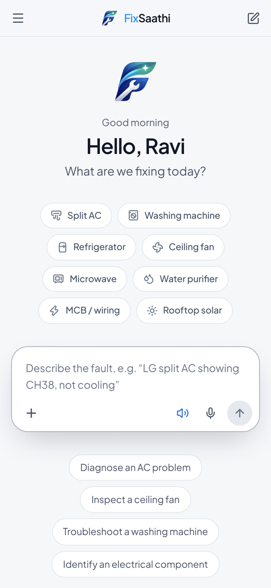
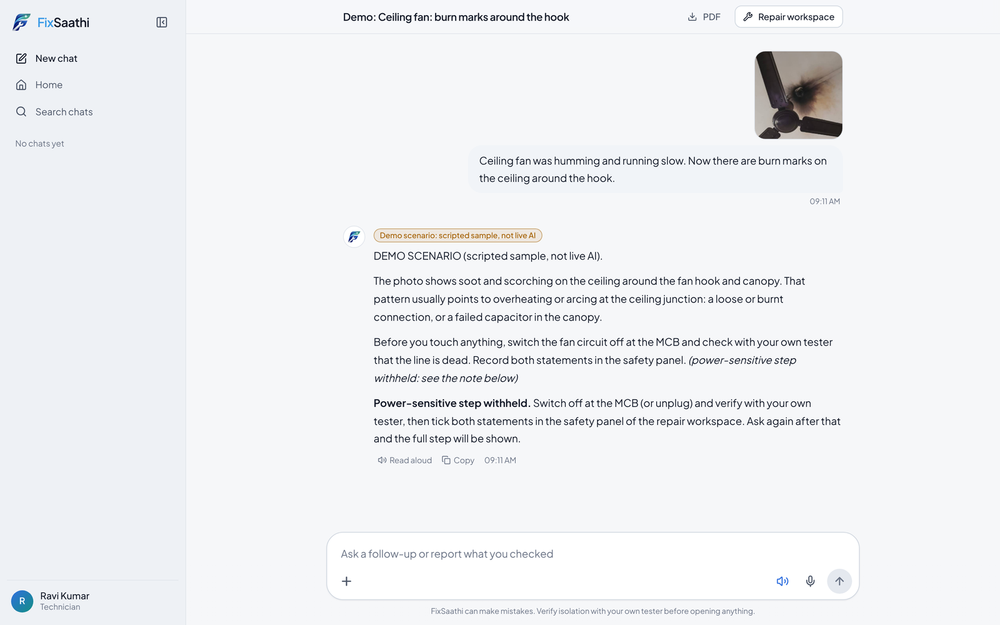
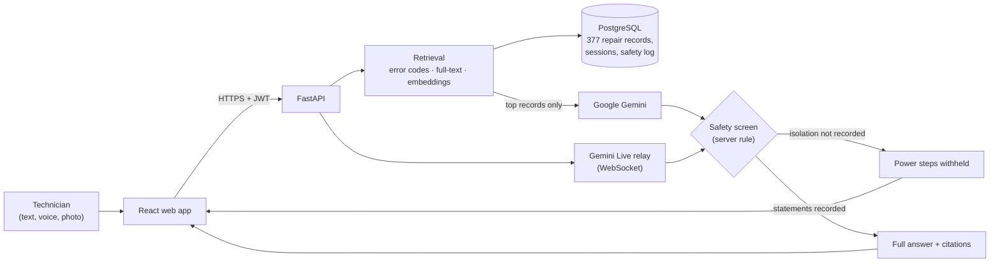

<div align="center">

# FixSaathi

**An AI repair copilot for appliance technicians in India: grounded diagnosis, a safety lock enforced by the server, and voice in English, Hindi and Kannada.**

[**Live app**](https://fixsaathi-copilot-v9cb.onrender.com) · [API docs](https://fixsaathi-copilot-api-v9cb.onrender.com/docs) · [Evaluation](docs/EVALUATION.md) · [Architecture](docs/ARCHITECTURE.md)


</div>

<table>
<tr>
<td width="68%"></td>
<td width="32%"></td>
</tr>
<tr>
<td colspan="2"></td>
</tr>
</table>

<sub>Screenshots from a local run. The chat and workspace show one of the app's built-in demo scenarios, which are labelled on screen as scripted sample content; the safety lock, the withheld step and the retrieved records are the real server code.</sub>

## The problem

Most AC, fridge and washing-machine repairs in India are done by independent technicians who work alone, with no service manual and no senior to call. They diagnose by trial and error, which wastes parts and time, and they sometimes work on appliances that are still live.

FixSaathi gives that technician a copilot on their phone: describe the fault by text, voice or photo, get a ranked diagnosis grounded in real repair records, then follow guided steps that the server will not reveal until the power is isolated. The service report writes itself.

## What it does

| | |
|---|---|
| **Grounded diagnosis** | Every answer is built from the repair records retrieved for that question (377 records: manufacturer documentation, the ApplianceDB error-code dataset and FixSaathi's own guidance). The server deletes any citation that was not retrieved, and marks a fault as unverified when no record supports it. |
| **Server-side safety lock** | Steps that need the power off are sent to the phone *without their instructions* until the technician records two statements: "power switched off at the MCB" and "checked with my own tester". AI chat and voice replies are screened sentence by sentence before anyone reads or hears them. Microwave internals are always handed over to authorised service. |
| **Voice, three languages** | Speak a fault, hear the answer. Gemini Live for real-time voice, with Gemini text-to-speech and the device voice as fallbacks. The interface works in English, Hindi and Kannada, and the search understands Hinglish ("pankha dheere chal raha hai") and Devanagari Hindi. |
| **Photos and documents** | Attach appliance photos, a camera capture, PDFs or Word files. The server checks every file's real type and strips location data from photos. |
| **Answer feedback** | Thumbs up or down on each AI answer, with a note on what was wrong. The manager dashboard shows the share of answers technicians found helpful. |
| **Reports and dashboard** | A service report and PDF built only from what was recorded in the session; a manager view with sessions, first-time-fix rate, escalations and ratings. |

## Results

Measured offline by [`backend/scripts/evaluate.py`](backend/scripts/evaluate.py) on hand-labelled fault descriptions written in the way technicians type them. The held-out set was written after all retrieval fixes and was not used to tune anything. Details, method and every miss: [docs/EVALUATION.md](docs/EVALUATION.md).

| Held-out set | Result |
|---|---|
| Correct repair record in the top 3 (30 queries; English, Hinglish, Hindi) | **96.7%** (Hit@1 83.3%, MRR 0.90) |
| Appliance detected correctly from free text | **96.7%** |
| Unsafe instructions withheld by the safety filter | **11 / 12** when first measured; 12 / 12 after the fix it led to |
| Safe text left readable | **11 / 12** |

These numbers cover retrieval (keyword and error-code channels, reproducible without an API key) and the safety rule. They do not grade the wording of Gemini's answers, and the queries were written by the team, not collected from technicians.

## How it works



1. **Retrieve.** The appliance comes from the session or is detected from the technician's words. Brand and error codes are extracted ("CH 38", "CH38" and the alias "F4" all reach LG's record). Records are ranked within that appliance: exact error-code matches first, then PostgreSQL full-text search and Gemini embeddings, whose scores are fused so a record found both ways ranks highest.
2. **Generate.** Gemini gets only the top records as tagged evidence, never the whole knowledge base (about 1,400 input tokens per reply).
3. **Screen.** `app/core/power_rules.py` is the single definition of "power-sensitive", shared by repair steps, chat, Live voice and the dataset importer, including Hindi verbs (*khol*, *nikal*, *badal*). `SafetyService.guard` is the only code path that can permit a power-sensitive action, and the AI has no tool that can record a safety statement. Every blocked attempt is logged.
4. **Fail safely.** Every Gemini failure is classified (bad key, quota, timeout, blocked...) and shown with a fix; the technician's message is saved either way. Rate limits fall back to the next model. Live audio that cannot be screened is not played.

## Engineering

- **Backend:** FastAPI, SQLAlchemy 2, Alembic, PostgreSQL 16, `google-genai`. JWT access and refresh tokens, organisation-scoped access for managers, rate-limited sign-in, uploads checked by content and re-encoded without location data.
- **Frontend:** React 19, TypeScript, Vite, Tailwind 4, Framer Motion, Recharts. Mobile-first, works on a phone browser.
- **Tests:** 383 automated tests: 330 backend tests run the real Alembic migrations on PostgreSQL with Gemini replaced by a deterministic fake, and 53 frontend tests (Vitest, Testing Library). Plus the offline evaluation above.
- **Data pipeline:** `scripts/process_datasets.py` normalises the sources into one schema with licence and verification status per record; `scripts/dataset_quality_report.py` reports coverage. See [docs/DATASET_ARCHITECTURE.md](docs/DATASET_ARCHITECTURE.md).
- **Deployment:** one Render Blueprint ([`render.yaml`](render.yaml)): static site, API and PostgreSQL. Secrets live only in Render's environment; a scheduled GitHub Action keeps the free-plan API awake.

```
frontend/   React app
backend/    FastAPI app: api/ routes · services/ (retrieval, AI, safety, reports) · integrations/gemini · tests/ · scripts/
data/       377 processed repair records, raw sources, schema, evaluation sets (data/eval)
docs/       architecture, API, safety and security, retrieval, voice, datasets, evaluation
```

## Run it locally

You need PostgreSQL 16, Python 3.12 and Node 22.19+ (or just Docker). A Gemini key is optional: without one, AI features say so clearly and the labelled demo scenarios still work.

```bash
# Docker: one command
python3 backend/scripts/setup_env.py --compose   # writes backend/.env and .env
docker compose up --build                         # app: http://localhost:5173  API: http://localhost:8000/docs
```

```bash
# Manual
createdb fixsaathi
cd backend && python3.12 -m venv .venv && source .venv/bin/activate && pip install -r requirements.txt
python scripts/setup_env.py --database-url "postgresql+psycopg://$USER@localhost:5432/fixsaathi"   # then add GEMINI_API_KEY to backend/.env
alembic upgrade head && python scripts/ingest_knowledge.py
uvicorn app.main:app --reload --port 8000

cd ../frontend && cp .env.example .env && npm ci && npm run dev
```

```bash
# Tests and evaluation
cd backend && createdb fixsaathi_test
DATABASE_URL=postgresql+psycopg://$USER@localhost:5432/fixsaathi_test SECRET_KEY=test-secret-key-0123456789-abcdefghijk pytest -q
cd ../frontend && npm test && npm run build && npm run lint
# evaluation: see docs/EVALUATION.md
```

## Honest limits

- **No field data yet.** FixSaathi has not been used on real jobs. The answer-feedback buttons exist so that the first pilot produces real numbers.
- **The safety statements are the technician's word.** FixSaathi cannot measure voltage or verify isolation, and the app and reports say so.
- **The knowledge base is small** (377 records, two-thirds of them washing-machine error codes). Answers outside it are marked as not grounded.
- **Free hosting.** The API runs on Render's free plan; the first request after an idle spell can take up to a minute.

## Team

Built by **Prerana P Jois** and **Priyam Thakur** (Team Tensor Trailblazers, BMS College of Engineering, Bengaluru) for the Google Startup Buildathon India 2026, where the project reached the end of Round 2.

## Data and licence

ApplianceDB-derived records are ODbL-1.0 (attribution and share-alike); manufacturer documentation is summarised with links to the source. See [docs/DATASET_SOURCES.md](docs/DATASET_SOURCES.md) and [docs/SOURCE_ATTRIBUTION.md](docs/SOURCE_ATTRIBUTION.md).
