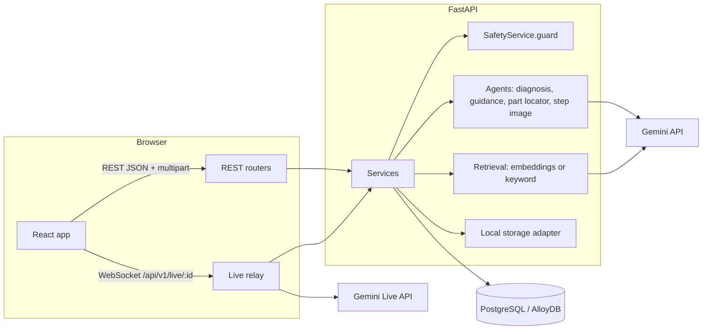
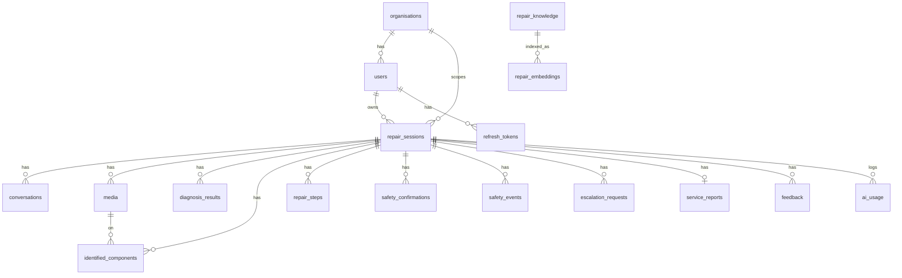

# Architecture

Layers: `api/v1` (HTTP only) → `services` (business rules, access policy, safety) → `db/models` and `integrations` (Gemini, storage). Prompts live in `app/agents/prompts.py`, and output schemas in `app/agents/schemas.py`. All model output is validated with Pydantic before use.

## ER diagram

## Session states

`created → active ⇄ diagnosing / awaiting_confirmation / guidance_in_progress / escalated → completed | cancelled`. Transitions are validated in `services/sessions.py`. `completed` and `cancelled` are terminal.

## Access policy (`services/access.py`)

- Technician: only their own sessions.
- Manager: read access to sessions in their organisation, and can update escalations. They cannot confirm safety or act on a technician's session.
- Admin: everything.
- A session someone may not see returns 404 rather than 403, so its existence is not revealed.
